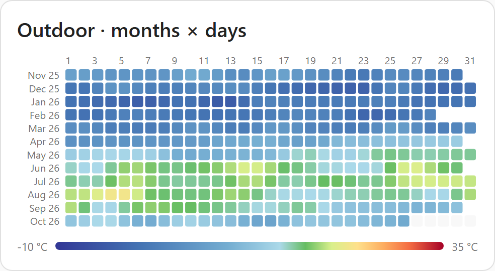
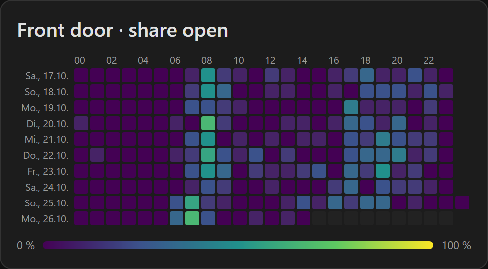
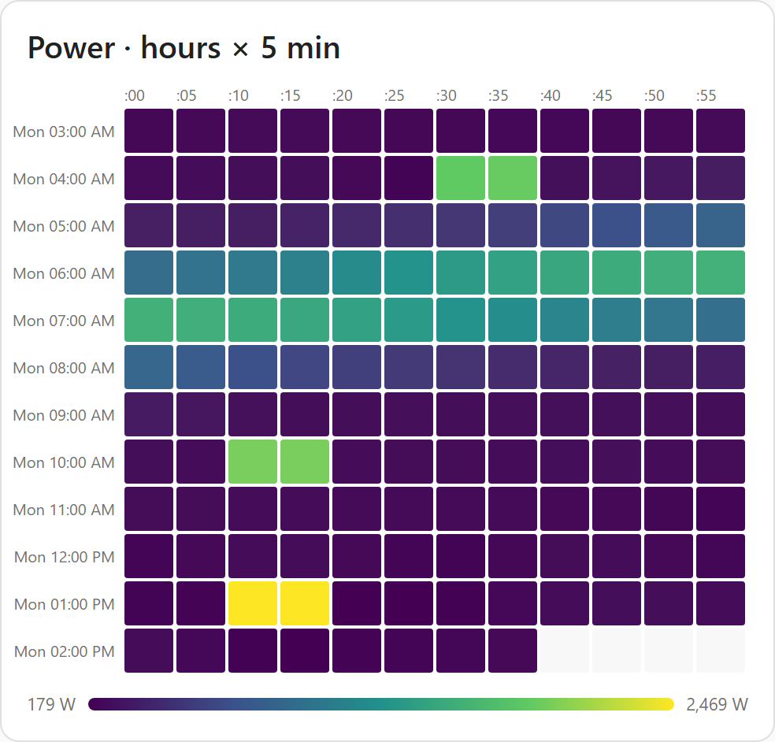

# Chrono Heatmap Card

A Home Assistant dashboard card that shows the history of one entity as a heatmap, with free choice of what a
row is: an **hour, day, week, month or year**. Columns are the matching subdivision (5 minutes, hours, days,
weeks, months).

| Rows (`row_unit`) | Columns (`column_unit`, **default** first) |
| ----------------- | ------------------------------------------ |
| `hour`            | **`5minute`**, `minute`                    |
| `day`             | **`hour`**                                 |
| `week`            | **`day`**, `hour`                          |
| `month`           | **`day`**                                  |
| `year`            | **`month`**, `week`                        |

Works with numeric sensors (mean / min / max / sum / last / change) and on/off entities (share of time "on").
Data comes from long-term statistics where possible and from the recorder history otherwise.

The card and its visual editor are available in English, German, French, Dutch, Spanish, Italian, Polish and
Swedish; the language follows your HA profile, other languages fall back to English.

**[▶ Try the interactive demo](https://sanieldous.github.io/chrono-heatmap-card/)** with mock data, no installation needed.

<p>
  
  
  
</p>

## Installation

### HACS (custom repository)

1. HACS → ⋮ → _Custom repositories_ → add this repository's URL, type **Dashboard**.
2. Install **Chrono Heatmap Card**, reload the browser.

### Manual

1. Download `chrono-heatmap-card.js` from the latest [release](../../releases).
2. Copy it to `config/www/` and add `/local/chrono-heatmap-card.js` as a dashboard resource (type _JavaScript module_).

## Configuration

Minimal:

```yaml
type: custom:chrono-heatmap-card
entity: sensor.outdoor_temperature
```

All options (also available in the visual editor, except `scale.steps`):

| Option            | Default                                                                                                | Description                                                                                                                      |
| ----------------- | ------------------------------------------------------------------------------------------------------ | -------------------------------------------------------------------------------------------------------------------------------- |
| `entity`          | –                                                                                                      | Entity to show (required)                                                                                                        |
| `title`           | entity name                                                                                            | Card title; click opens the more-info dialog                                                                                     |
| `row_unit`        | `day`                                                                                                  | `hour` · `day` · `week` · `month` · `year`                                                                                       |
| `column_unit`     | depends on `row_unit`                                                                                  | see table above                                                                                                                  |
| `rows`            | hour 12, day 14, week 8, month 6, year 2                                                               | Number of rows; the last row is the current period                                                                               |
| `orientation`     | `horizontal`                                                                                           | `vertical` swaps rows and columns                                                                                                |
| `source`          | `auto`                                                                                                 | `auto` · `statistics` · `history`                                                                                                |
| `aggregation`     | auto                                                                                                   | `mean` · `min` · `max` · `sum` · `last` · `change` · `on_ratio` (auto: meters → `change`, numeric → `mean`, others → `on_ratio`) |
| `on_states`       | by domain                                                                                              | States counted as "on" for `on_ratio` (default `on`; person/device_tracker `home`, cover `open`, media_player `playing`, …)      |
| `scale.preset`    | from device class: temperature, humidity, CO₂, PM2.5, battery (reversed traffic light); else `viridis` | `temperature` · `humidity` · `co2` · `pm25` · `traffic` · `viridis` · `mono`                                                     |
| `scale.reverse`   | `false`                                                                                                | `true` flips the colors of the scale (e.g. `traffic` for "high is good")                                                         |
| `scale.type`      | from preset                                                                                            | `absolute`: step values in entity units · `relative`: step positions 0–1 spread over min..max                                    |
| `scale.min`/`max` | from data                                                                                              | Fixed range for relative scales                                                                                                  |
| `scale.steps`     | –                                                                                                      | Custom color steps (`value`, `color`) – YAML only                                                                                |
| `show_legend`     | `true`                                                                                                 |                                                                                                                                  |
| `show_labels`     | `true`                                                                                                 |                                                                                                                                  |

Example with custom steps:

```yaml
type: custom:chrono-heatmap-card
entity: sensor.office_co2
row_unit: week
column_unit: hour
scale:
  steps:
    - { value: 400, color: '#1a9850' }
    - { value: 800, color: '#fee08b' }
    - { value: 1200, color: '#d73027' }
```

Notes:

- Times follow your HA profile (time zone _server/local_, first weekday, language). DST days keep hours under their wall-clock column; the repeated autumn hour gets an extra column at the end.
- In time zones with a :30/:45 offset the card always uses history, because statistics are aligned to whole UTC hours.
- Raw history and 5-minute statistics are kept only as long as the recorder keeps them (default 10 days);
  hourly statistics are kept forever. `minute` columns and on/off entities always use history.
- Gaps in the statistics (e.g. HA was down, or the sensor got a `state_class` recently) are filled from history
  while the recorder still has it.
- `change` follows HA: for `total_increasing` meters a drop of more than 10 % is a meter reset, smaller drops count
  as negative change; `total` meters (e.g. net import/export) may go down.
- Automatic color scales by device class (only for mean/min/max/last): `temperature` (°C/°F), `humidity` (%,
  green at 40–60 %), `co2` (ppm, green below 800, red above 1400), `pm25` (µg/m³, European Air Quality Index
  bands), battery as reversed `traffic` from 0 to 100 %. With an unexpected unit the preset is spread over the
  data range instead.
- `sum` adds up the per-period means (e.g. hourly averages of a power sensor); for meters use `change`.
- `year` × `week` columns are labelled with calendar weeks (ISO weeks when the week starts on Monday) of the
  current year; a week belongs to the year it starts in.
- Interaction: hover (mouse) or tap (touch) shows a tooltip; click (mouse) or a second tap opens more-info.

## Development

Requirements: Node.js LTS and pnpm (works in WSL2, no Docker needed).

Dependencies are pinned to exact versions, and `pnpm-workspace.yaml` sets `minimumReleaseAge` plus a few
overrides. This keeps installs working behind npm proxies that only serve versions they have already cached.
Remove a pin once your registry serves newer versions.

[Renovate](https://docs.renovatebot.com/) opens update PRs on Mondays (`renovate.json`): only versions at least
30 days old (same as `minimumReleaseAge`), small devDependency updates grouped, Playwright separately (it needs a
matching local browser: `pnpm exec playwright install chromium`).

```bash
pnpm install
pnpm dev          # dev page with mock data + hot reload → http://localhost:5173/dev/index.html
pnpm test         # unit tests (Vitest)
pnpm screenshots  # Playwright screenshots of the dev page → screenshots/
pnpm build        # dist/chrono-heatmap-card.js
pnpm build:demo   # static dev page → dist-demo/ (deployed to GitHub Pages on every push to main)
```

The dev page renders a gallery of configurations plus a YAML playground, with a mock `hass` that answers the
recorder/history WebSocket calls from deterministic fake sensors. URL parameters: `now`, `theme=dark`, `lang=de`,
`only=<gallery id>`, `playground=0`.

The visual editor (`getConfigForm`) is rendered by Home Assistant itself and can only be seen in a real HA
instance: copy `dist/chrono-heatmap-card.js` to `config/www/`.

### Commits & releases

PR titles follow [Conventional Commits](https://www.conventionalcommits.org/) (squash merge). Every merge to `main`
runs semantic-release, which picks the next version, creates the tag and a GitHub release with the bundle.
